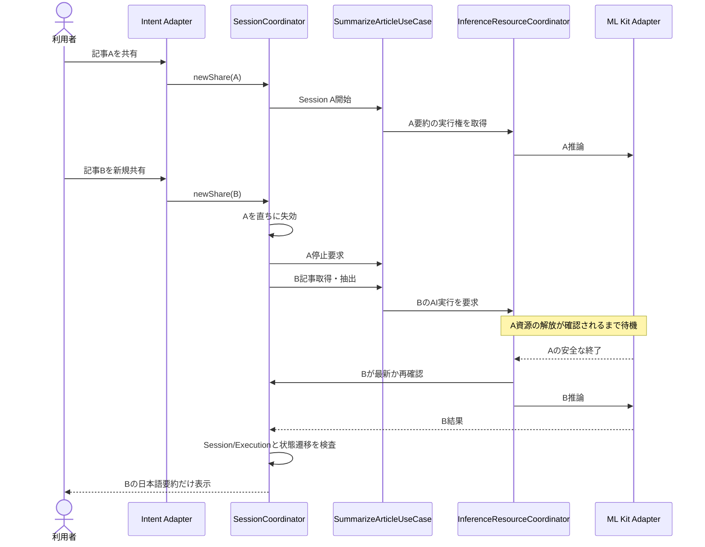
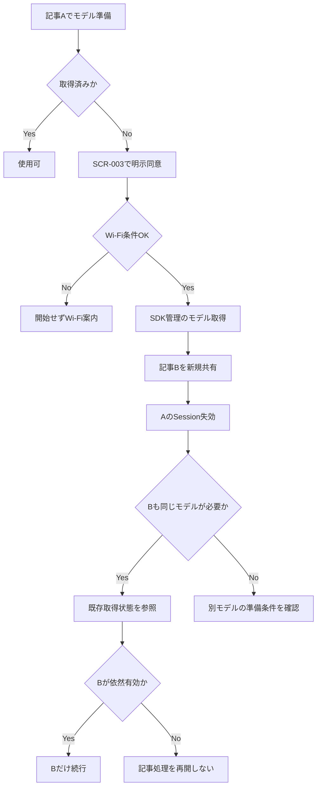

# 05. 画面（SCR）・処理フロー（PF）仕様

**版:** v2.7 / **状態:** 論理設計確定。SDK依存挙動はPoC対象。

## 1. SCRレジストリ

| ID | 画面 | 表示内容 | ユーザー操作・遷移 |
|---|---|---|---|
| SCR-001 | 利用案内／ホーム | Chromeからの共有手順・プライバシーリンク。URL手入力欄なし | 共有Intent待ち／SCR-006を開く |
| SCR-002 | 進行画面 | 取得、抽出、言語判定、モデル準備、AI資源待ち、要約、翻訳の現在段階 | キャンセル・Backで即時に記事セッション終了→SCR-001 |
| SCR-003 | モデル取得の明示承認 | 未取得モデル、取得に通信と保存容量が必要、Wi-Fi条件、取得中状態／可能なら進捗 | 同意してWi-Fiで取得／キャンセルで記事終了。旧モデル取得はSDK管理で続く場合あり |
| SCR-004 | 日本語要約結果 | 記事タイトル・サイト、非空1〜3箇条、切り詰め警告 | コピー、元記事を外部ブラウザで開く（セッション終了）、新共有で置換 |
| SCR-005 | エラー | ERRコード、理由、対処、条件付き「再試行」「閉じる」 | 許可されたERRだけ手動再試行、閉じる→SCR-001 |
| SCR-006 | プライバシー情報 | 外部HTTPSの公開プライバシーページ | SCR-001から外部遷移。Composeの画面ルートは不要 |

通常の非イマーシブActivityとComposeで描画する。重要なコントロールにはTalkBackラベルを設け、文字サイズ拡大へ対応する。進捗％はSDKの事実に基づく場合に限る。

## 2. 画面状態（UDF）

```text
Home
Processing(stage, sessionId)
ModelConsent(modelKind, networkState)
WaitingForModel(modelKind, sdkProgress?)
WaitingForInferenceResource
Result(title?, site?, bullets[1..3], isPartial)
Error(ERR, message, advice, retryAllowed)
```

状態はSessionCoordinatorが判断し、ViewModelが画面用UiStateへ変換して`StateFlow`から公開する。Compose再描画は処理開始トリガーにしない。SCR-006は外部ページへのナビゲーションであり、情報の正本は公開URLで管理する。

## 3. PFレジストリ

| ID | 処理フロー | 主な段階・例外 |
|---|---|---|
| PF-001 | 共有イベント受信 | ACTION_SENDの新規性判定、URL1件抽出、SessionId生成、旧Session無効化。URL一致で重複排除しない |
| PF-002 | URL安全検証・HTML取得 | Scheme→DNS/接続先→HTTP(S)→手動リダイレクト再検査→上限管理。危険値はERR-002〜005 |
| PF-003 | HTML抽出・言語判定 | タイトル／本文抽出→品質・文字数→JA/EN/不明。ページ全体で無条件代替しない |
| PF-004 | モデル準備 | FeatureStatus照会→同意/Wi-Fi→ダウンロード→利用可。同じモデル構成の取得を共有。記事キャンセルでもSDK管理の取得継続許容 |
| PF-005 | 日本語記事要約 | 共通AI実行権→日本語Summarization→結果検査→SCR-004。解放・旧Sessionチェック |
| PF-006 | 英語記事要約・翻訳 | 共通AI実行権で英語Summarization→安全解放→翻訳の実行権→日本語訳→検証 |
| PF-007 | 手動再試行 | ERRが許可した場合のみ新ExecutionIdを生成し、URL検証・HTTPから再実行。中間データ再利用なし |
| PF-008 | セッションキャンセル | USER_CANCEL/BACK_NAVIGATION/FOREGROUND_LOST/SUPERSEDED/SOURCE_OPENED/PROCESS_TERMINATED |
| PF-009 | 回転・前面・プロセス死 | 構成変更は状態継続、トップフォアグラウンド喪失は記事終了、プロセス死から自動復元なし |
| PF-010 | 連続共有・遅延結果 | A/B/Cの最新のみを有効化、古い結果を拒否、AI実行権は旧資源の安全解放待ち、モデル取得を共有 |
| PF-011 | Firebase診断 | 安全な診断イベント→TelemetryReporter→3製品。生URL/本文/AIデータ/独自相関ID禁止、自動計測は別検証 |
| PF-012 | 結果の操作 | 1〜3要点・切り詰め警告、コピー、元記事外部起動。外部遷移ではセッション終了 |

## 4. PF-010：最新共有と共通AIゲート



**終了待ちの上限:** 有限でなければならない。数値はTV-007/008とADR-004で承認する。上限を超えて安全解放が未確認ならAIを新規起動せずERR-015に分類し、端末を占有し続けない。SDKに信頼できる解放確認が存在しない場合は、MUSTとの不整合としてPoC不合格・再設計とする。

## 5. PF-004：モデル取得・再利用



翻訳モデルとSummarizationモデルは同一SDK機構とは限らない。ダウンロードの重複抑止・Wi-Fi制御・継続可否は機能ごとにTV-009/010で確証を得る。

## 6. イベントの優先順序

1. 新規共有イベントを受信したら旧Sessionを**同期的に失効**させる。
2. 新しい処理画面へ切り替え、旧非同期Jobをキャンセル要求する。
3. 旧AI操作は解放監視を継続するが、旧Sessionの結果・ERR・画面通知を拒否する。
4. 新記事の取得・抽出は、旧AIの解放待ちと独立に進めてよい。
5. 新記事のAI実行段階では共通ゲートを取得する。古い待機候補をすべて無効化。
6. **状態更新は**(SessionId, ExecutionId, 有効状態, 遷移可能性)**を一体で検査**してコミットする。

## 7. ライフサイクル判定の境界

トップの最前面を本当に失ったときにキャンセルする。画面回転・Compose再描画・単なる再生成を「離脱」と誤判定しない。OSのウィンドウ・フォーカス・ActivityコールバックとComposeのライフサイクルの適用方法はTV-011で検証する。システムダイアログ、マルチウィンドウ等の誤判定もPoC対象。

## 8. 対応する主なAC

PF-010: AC-095〜123, AC-135〜139, AC-161〜164。PF-009: AC-100〜108, AC-129, AC-132, AC-162〜163。PF-011: AC-140〜144, AC-149〜157。詳細は`03`、NACは`04`。
