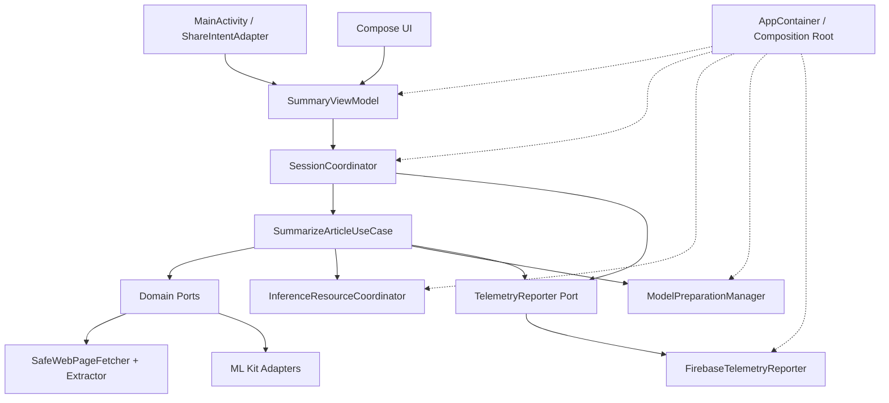

# 06. アーキテクチャ・依存方向・所有関係

**版:** v2.7 / **状態:** 論理設計確定・SDK依存方式はPoC/ADR後。

## 1. 決定した技術構成

- Android / Kotlin / Jetpack Compose / Single Activity。
- **単一`:app` Gradleモジュール**内で`presentation`、`application`、`domain`、`data`、`platform`の責務を区別。
- **手動DI**。Applicationに近いComposition Root / `AppContainer`で具体Adapterを組み立て、コンストラクタで注入。
- ViewModelとSessionCoordinatorを分離。ViewModelは`StateFlow`で画面状態を公開し、SessionCoordinatorがセッション切替と状態採用を司る。
- AI要約と翻訳を**共通のInferenceResourceCoordinator**で直列化。ModelPreparationManagerは独立。
- Application/DomainからFirebase/ML Kit/HTTPライブラリの具体SDKへ依存しない。
- Firebaseへの明示的記録は共通TelemetryReporter Portで集約。SDKの自動収集はその外部と認識する。

## 2. ARCHレジストリ

| ID | アーキテクチャ要件 |
|---|---|
| ARCH-001 | Single Activity構成 |
| ARCH-002 | 単一`:app` Gradleモジュール |
| ARCH-003 | ViewModelとSessionCoordinatorの責務分離 |
| ARCH-004 | Domain/ApplicationからSDK具体実装への直接依存禁止 |
| ARCH-005 | 共有Intent受付とセッション開始の責務分離 |
| ARCH-006 | AI排他制御は記事セッションより長いスコープを持つ |
| ARCH-007 | モデル準備管理は記事セッションより長いスコープを持つ |
| ARCH-008 | データ所有者・保持期間・参照解放を明確化 |
| ARCH-009 | 主要外部依存をTest Doubleへ差し替え可能 |
| ARCH-010 | Firebaseへの明示的な診断を中央管理 |
| ARCH-011 | 手動DI / Composition Rootを採用 |
| ARCH-012 | コンストラクタ注入を基本とする |
| ARCH-013 | Application・ViewModel・Executionのスコープを区別 |
| ARCH-014 | 要約と翻訳の共通AI実行権ゲートを使用 |
| ARCH-015 | AI実行権を明示的に取得・終了・状態監視 |
| ARCH-016 | モデルダウンロードとAI実行ゲートを分離 |
| ARCH-017 | 共通TelemetryReporter Portを採用 |
| ARCH-018 | Firebase3製品の振り分けをInfrastructureに閉じる |
| ARCH-019 | 診断URL検査・禁止データ除外を共通化 |
| ARCH-020 | Firebase SDKの自動収集をPortとは別に検証 |

## 3. コンポーネント構成



アーキテクチャ図のPort→Adapterは**実行時接続**を示し、ソースコードの依存方向は逆（AdapterがDomain Portを実装）。Domainが実SDKをimportしてよいという意味ではない。

## 4. 所有者・責務・禁止事項

| コンポーネント | 所有・スコープ | 責務 | 禁止事項 |
|---|---|---|---|
| MainActivity | Activity | 通常起動・共有・ライフサイクルの入口 | HTTP/ML Kitを直接操作しない |
| ShareIntentAdapter | Android境界 | MIME/Intent解析・新規イベント化 | URLの安全なDNS検査を担当しない |
| SummaryViewModel | ViewModelStore | UiState変換とUIイベント受付 | セッションの最終有効性判断を持たない |
| SessionCoordinator | Activity ViewModelと同等 | SessionId・ExecutionId・失効・状態遷移 | SDKの具体型・Activity Contextを保持しない |
| SummarizeArticleUseCase | Execution | 取得から日本語結果までの順序・入力保持 | コンテンツの永続保存を行わない |
| InferenceResourceCoordinator | Applicationプロセス | 要約/翻訳の共通実行権、解放確認・待機期限 | 解放未確認なのに新実行権を発行しない |
| ModelPreparationManager | Applicationプロセス | モデルの可用性・取得共有・重複抑止 | URL・本文・要約結果を保持しない |
| TelemetryReporter | PortとApp共有Adapter | 安全な診断と3製品への振り分け | 元例外・本文・生URLを渡さない |
| AppContainer | Applicationプロセス | 具体Adapter生成とスコープの配線 | グローバルな記事セッションキャッシュを作らない |

**補足:** 旧推論が継続中にセッション参照を解放しても、SDK内部が元入力を持ち続ける可能性がある。アプリの保有参照を削除する義務と、SDK資源の物理解放確認を分けて管理する。

## 5. Port / Adapterの対応

| Domain Port | Adapter候補 | テスト版 |
|---|---|---|
| ArticleRepository / WebPageFetcher | OkHttp + 安全なリダイレクト・接続先検査 | FakeArticleRepository / MockWebServer |
| ArticleExtractor | jsoup + Readability系アルゴリズム | FakeArticleExtractor + HTML fixture |
| LanguageDetector | ML Kit Language Identification | FakeLanguageDetector |
| ArticleSummarizer | ML Kit GenAI Summarization | FakeSummarizer |
| TextTranslator | ML Kit Translation | FakeTranslator |
| ModelAssetGateway | ML Kit/AICoreモデル状態・取得 | FakeModelAssetGateway |
| TelemetryReporter | Firebase Analytics/Performance/Crashlytics | RecordingTelemetryReporter |
| ForegroundStateProvider | Android最前面監視Adapter | FakeForegroundStateProvider |
| ExternalNavigator | Android Intent Adapter | FakeExternalNavigator |

これらの具体Adapterとバージョンは**未承認**。PoCで互換性・安全性を確認してADR-001〜007で採用する。

## 6. データと依存方向

```text
:app
  app/               MainActivity, SummaryApplication, AppContainer
  presentation/      Compose, SummaryUiState, SummaryViewModel
  application/       SessionCoordinator, UseCase, AI Gate, ModelManager
  domain/model/      ArticleUrl, ExtractedArticle, SummaryResult, Session state
  domain/port/       ArticleRepository, AI, Model, Telemetry, Foreground
  domain/policy/     ErrorClassifier, TelemetryHostPolicy
  data/web/          OkHttp/HTML Adapter（ADR承認後）
  data/ai/           ML Kit Adapter（ADR承認後）
  data/telemetry/    Firebase Adapter（ADR承認後）
  platform/          ShareIntentAdapter, ForegroundObserver, Navigator
```

**禁止:** `domain`→`data`、`application`→具体SDK、`presentation`→Firebase SDK、Compose UI→直接ネットワーク処理。**許可:** Composition Rootから具体AdapterとPortの双方を参照して配線する。

## 7. SessionCoordinatorの状態採用条件

```text
採用可 = currentSessionId == event.sessionId
       && currentExecutionId == event.executionId
       && sessionStatus == ACTIVE
       && transitionAllowed(currentState, event)
```

判定と状態更新を一体で行う。排他またはイベント直列化を採用し、検証直後の割り込みにより旧結果が反映されないようにする。URLが同じことを理由に別の共有操作を重複排除しない。`onNewIntent`と起動Intentの重複はTV-012で検証する。

## 8. AIリソースとモデルの異なるライフサイクル

- AI実行権は日本語要約、英語要約、日本語翻訳の**すべて**に共通。取得待ち・モデルダウンロード中には保持しない。
- 新共有を即時受付し、旧Sessionを失効させる。古いAI操作は安全な解放確認までゲートを塞いでよいが、待機は有限で、確認不能ならERR-015へ。
- APIのキャンセルFuture完了とAICore内部資源解放を同一視しない。判定可能性はTV-007で検証する。
- モデル取得はSDK管理の継続を許容し、同モデルに対する新Sessionから参照できる。ただし新たなモデル構成をダウンロードする場合は承認とWi-Fi条件を再検査。
- SDK内に安全な解放判定が存在しない等、MUSTを満たせない場合はPoC不合格・人間判断とし、ゲート解除の強行はしない。

## 9. 初期テスト設計

`app/src/test`にCoordinator/UseCase/HostPolicy/AI GateのJVM Test、`app/src/androidTest`にSingle Activity、Intent、画面回転、最前面喪失、Compose UIを置く。Fakeはプロダクション環境から切離し、CIは実SDKに依存せず大部分を検証可能とする。実機固有はPixel 9 Pro XLのPoC・RCテストで証明する。
