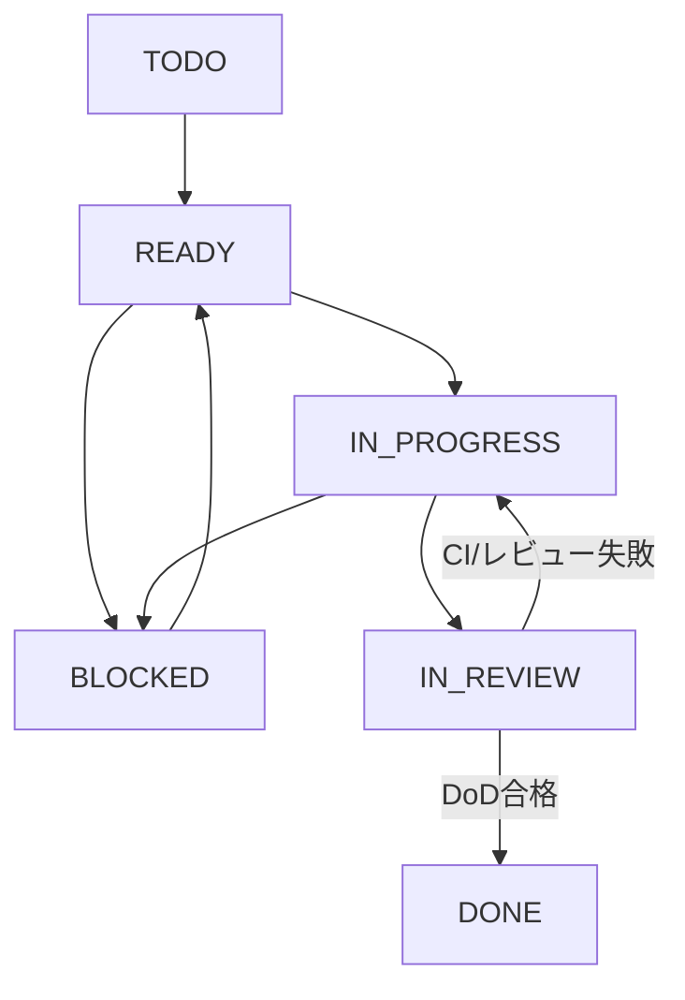

# 10. Codexへの開発指示・ガバナンス・運用規則

**版:** v2.7 / **状態:** 運用仕様確定。Skill/CI/Issueは未設置または未作成。実行実績ではない。

## 1. 役割分担

| 領域 | Codex（AI） | 人間 |
|---|---|---|
| 仕様 | 質問・検証・差分案、AC更新案 | MUST要件と変更の承認 |
| 技術 | 調査・比較・PoC・ADR提案 | ADR採否・MG-02a/b承認 |
| 開発 | Issue単位の設計/実装/自動テスト/文書更新 | 主要マイルストーンの承認 |
| 実機 | 自動化可能な検証手順と結果整理 | Pixel9 Pro XL実操作・人間によるAI品質評価 |
| 配布 | Release候補の証跡・手順作成 | Google Play公開資格確認・最終公開承認 |

## 2. 3層の強制方法

1. **Policy:** ルート`AGENTS.md`。禁止事項、承認ゲート、Worktree、プライバシー、DoDを簡潔に記載。
2. **Knowledge:** `docs/01〜10`、ADR、`.codex/skills/worktree-management`（別途導入が必要）。手順や理由を管理。
3. **Enforcement:** GitHub Branch Protection/Rulesets、PR必須CI、Unit/Emulator/Privacy Test、承認証跡チェック。Policyだけを「強制済み」と扱わない。

## 3. CODレジストリ（COD-001〜030）

| ID | Codexの規則 |
|---|---|
| COD-001 | 変更を伴うIssue Taskは原則専用Worktree |
| COD-002 | Worktreeの作成・管理・削除は承認済み`worktree-management` Skill経由 |
| COD-003 | 着手前にWorktreeのTrusted状態と`.codex`ルールの適用を検査 |
| COD-004 | 利用者が承認していないパスを自動でTrustedにしない |
| COD-005 | 依存・ファイル・インターフェースが独立したタスクだけ並列化 |
| COD-006 | Worktreeを越え未コミット変更を暗黙共有しない |
| COD-007 | 統合・作業状態を確認した後にWorktreeを安全に削除 |
| COD-008 | 着手前にTask ID、FR/NFR、AC/NAC、範囲を確認 |
| COD-009 | 前提Taskが完了しているか確認し未達はBLOCKED |
| COD-010 | MG-02a/02bが人間承認済みか検査。本実装の前提とする |
| COD-011 | 対象の主要ADRがAcceptedか検査し未承認技術の正式採用を禁止 |
| COD-012 | Skill/Trusted/適用ルールの準備を検証できなければ変更に着手しない |
| COD-013 | 並列Issueと変更ファイル/インターフェース競合を事前に確認 |
| COD-014 | 全PRでGradle Build/Android Lintを実行 |
| COD-015 | 全PRでJVM Unit/Component Testを実行 |
| COD-016 | 全PRでEmulator Smoke Testを実行 |
| COD-017 | 全PRでURL接続先・診断データのPolicy Testを実行 |
| COD-018 | 全PRで依存方向・禁止SDK参照の検査を実行 |
| COD-019 | Emulator網羅的テストを定期とRCで必須とする |
| COD-020 | Task・要件・ADR・テストの追跡可能性をPR/RCで検証 |
| COD-021 | Pixel/40記事/FirebaseのRC固有証跡を照合する |
| COD-022 | **同時稼働Codex Taskは最大2件**。PoCもTaskとして数える |
| COD-023 | GitHub IssuesをTaskの状態・担当・依存・PRの唯一の正本とする |
| COD-024 | GitHub Issueの状態を事実に合わせて更新。Markdown内に別の状態台帳を作らない |
| COD-025 | P0 PoC全部とADR-001〜007全部の人間承認前にPLAN-004以降の本実装を禁止 |
| COD-026 | PoC専用コードは原則本実装へ流用しない。再利用時はレビュー・テスト・承認 |
| COD-027 | Worktree名・ブランチ名・PRタイトルにTask IDを含める |
| COD-028 | CIが失敗・未実施ならマージしない。未実施をPASSとして報告しない |
| COD-029 | Task完了報告に変更・テスト・未実施・リスク・承認待ち・PRを含める |
| COD-030 | Playアカウント資格が未確認なら公開準備はBLOCKED。必要なクローズドテストを省略しない |

## 4. ステップ16確定の運用値

| 設定 | 値 |
|---|---|
| Task正本 | **GitHub Issues** |
| 並列上限 | **2タスク** |
| 作業分離 | IssueごとにGit Worktree |
| Branch命名 | `task/017-share-intent`, `poc/007-http-security`など |
| Worktree命名 | `worktrees/task-017-share-intent`など |
| PR名 | `[TASK-017] 共有Intent`など |
| 本実装解禁 | **MG-02a AND MG-02b**（全P0・全主要ADR） |
| Playアカウント | **未作成・不明。TASK-037で確認** |

### Skillの導入状態について

この成果物は`worktree-management` Skillを含まない。過去に別途作成したSkillを、**実際に対象のリポジトリへ設置して検証する必要がある**。Skill不存在やスクリプトの実行不能を回避するために、Codexが未承認の直接git worktreeコマンドを独断で実行しない。TASK-036の準備で、Skillの所在・権限・Trusted確認処理・使用可能なPython環境を検証する。

Codexのproject trustはユーザー側の設定であり、単にSkillフォルダがあるだけでWorktreeがTrustedになるとは限らない。ユーザーが事前承認した作業用パスだけを対象にする。設定の反映を確認できなければBLOCKEDにする。

## 5. Taskライフサイクル（GitHub Issues正本）



GitHub Issueには次のメタデータを記す。

- Task ID、所属PLAN、担当、優先度、見積ではなく実行可能なスコープ。
- 対応FR/NFR/ARCH/AC/NAC。PoCならTV、採用判断ならADR。
- Dependenciesとして先行Issue番号、MG-02a/02b、ADR状態を明示。
- PR・Worktree・ブランチリンク、必要テストと結果、DoDチェック、未解決リスク。
- Task状態はIssueラベル・Projectフィールド等から管理。ファイルに複製して別の正本にしない。

**一括ゲートの例:** TASK-018のHTTP技術がADR-001だけAcceptedになっていても、MG-02aとMG-02bがまだ承認されていないなら本実装はBLOCKED。先行実装を許すような条件分岐を禁止。

## 6. Git Worktreeの並列化とTrusted

1. IssueのREADY条件と同時稼働数（最大2）を検査。
2. 過去に承認済みの`worktree-management` SkillでWorktreeを作成する。
3. Trusted状態、AGENTS.mdと`.codex/rules`が適用されることを確認。
4. 個別Worktreeで開発・ローカルテスト・PRを作成。共有ファイルの競合は事前検査。
5. CI・通常レビュー・該当MGを通過してマージ。
6. 未コミットの変更・未統合の成果物がないことを確認してSkill経由で削除。

**失敗時:** Skillが見つからない、信頼設定に失敗、未承認パスの信頼追加が必要、CI未整備などの場合、IssueをBLOCKEDとして人間へ原因と是正案を報告する。

## 7. ADR承認の条件

- ADRは`Proposed / Accepted / Rejected / Superseded`を使用。
- Acceptedには候補比較、実機PoC、セキュリティ・Privacy・品質・ライセンスと保守性の根拠、採用バージョン、人間の承認者/日付を必須とする。
- 提案やPoC成功を人間の承認と同一視しない。Codexが自分の判断でAcceptedへ変更しない。
- 未承認ライブラリ・要件矛盾・P0未達に遭遇したら独断で要件を緩和せず、調査と代替案のIssue/ADRを起案する。

## 8. CIと人間の承認

- PR必須: Build/Lint、JVM Unit/Component、Security/Privacy Policy、Emulator Smoke、依存方向、追跡情報。
- 定期: Emulator全件。
- RC: Emulator全件、Pixel実機、日英40記事の人間品質評価、Firebase3製品の実送信・自動収集検証、Google Play資格、GATE-01〜12、MG-06。
- GitHub Rulesets/Branch Protectionへ必須Status Checksを登録すること。CI未実装のうちは「強制済み」としない。
- 人間承認が必要なMGはPRやIssueに承認記録へのリンクを残す。単なるマージを自動的にMG承認とみなさない。

## 9. Codex完了報告（毎Task）

```markdown
# TASK-xxx 作業報告
- Issue: <URL>
- PR/Branch/Worktree: <識別情報>
- 状態: IN_REVIEW / BLOCKED / DONE
- 対象要件・AC/NAC: <ID>
- 依存Task・ADR・PoCゲート: <確認結果>
- 変更点: <主なファイルと理由>
- 実施テスト: <コマンドとPASS/FAIL/BLOCKED/NOT_RUN>
- Emulator: <結果・端末構成またはNOT_RUN>
- 実機: <Pixel 9 Pro XLでの実施内容、またはNOT_RUN>
- CI: <リンクと結果>
- Privacy/Security影響: <確認事項>
- 残課題・制約: <あり/なし>
- 人間の承認待ち: <判断事項・対象MG>
- DoD: <未達条件があれば状態をDONEにしない>
```

推測で実機テストやFirebase送信検証をPASSと書かない。完了まで到達していない場合は、成果・未実施・次に必要な作業を率直に示す。

## 10. Release/公開ルール

Play Consoleのアカウントは**未作成・不明**。内部テストから製品版へ直接進める資格があるとはまだ判断できない。2023-11-13以降作成の個人アカウント等で12人/14日間連続の必須クローズドテストと製品版アクセス申請が適用される場合は実施する。製品版の公開操作は人間の最終承認後のみ。公開国は日本。Pixel以外の実機互換性は未検証と記録。

参照（2026-10-10確認）：https://support.google.com/googleplay/android-developer/answer/14151465?hl=ja

## 11. 他文書へのリンク

[03 FR/ERR/AC](03-functional-requirements.md)、[04 NFR/NAC](04-nonfunctional-requirements.md)、[06 Architecture](06-architecture.md)、[08 Tests](08-test-strategy.md)、[09 Plan](09-implementation-plan.md)、[ADRテンプレート](adr/ADR-TEMPLATE.md)、[Issueテンプレート](../.github/ISSUE_TEMPLATE/implementation-task.md)。
